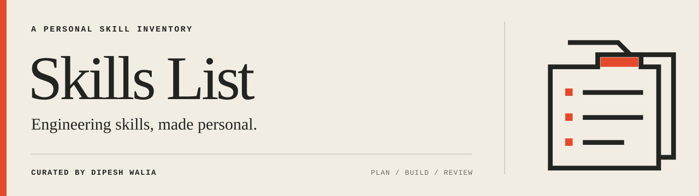

<p align="center">
  
</p>

<p align="center">
  <a href="skills/README.md">Browse skills</a> ·
  <a href="INVENTORY.md">Inventory & credits</a> ·
  <a href="docs/skillshare.md">Skillshare setup</a> ·
  <a href="docs/upstreams.md">Upstream workflow</a>
</p>

**A personal collection of AI agent skills for planning, building, reviewing, and writing.** Curated by [Dipesh Walia](https://github.com/dipeshwalia), with editable upstream copies, mergeable updates, and credit to every original source.

## Invoke by category

Category names become invocation prefixes. The skill's original name identifies its domain within the category:

| Category | Examples | Browse |
| --- | --- | --- |
| Workflow | `/workflow-improve`, `/workflow-grill-me`, `/workflow-tdd`, `/workflow-dry-refactoring` | [Workflow skills](skills/README.md#workflow) |
| Writing | `/writing-unslop`, `/writing-technical-writing`, `/writing-i-have-adhd`, `/writing-simple-english` | [Writing skills](skills/README.md#writing) |

The [skills directory](skills/) contains real packages named `workflow-improve`, `writing-unslop`, and so on. Hosts may expose their own invocation syntax; these are the installed skill names. The [full inventory](INVENTORY.md) records every selected skill, supporting dependency, original author, license, and reviewed revision.

## Get started

Requires Python 3 and Git with `git subtree`. Clone with Git so the upstream merge history travels with the files:

```sh
git clone https://github.com/dipeshwalia/skills-list.git
cd skills-list
python3 scripts/build-skills.py --check
```

To distribute the packages, follow the [Skillshare setup guide](docs/skillshare.md). Adapt [the configuration example](skillshare.config.example.yaml) so `sources.skills` points at your checkout's root. The root [`.skillignore`](.skillignore) selects only `skills/`, and `target_naming: standard` preserves the category-prefixed names.

## Select and customize

[sources.json](sources.json) is the single inventory record: each original project's author, license, and reviewed revision, plus every selected skill with its category, purpose, role, and required or recommended companions. [sources.ts](sources.ts) exports the same records through typed interfaces. The builder validates them and generates the attribution tables in this README, the [inventory](INVENTORY.md), and the [catalog](skills/README.md); edit the records, not the tables.

Edit the canonical copies under `upstreams/`, then generate the packages:

```sh
python3 scripts/build-skills.py
python3 scripts/build-skills.py --check
```

The builder keeps references, scripts, invocation metadata, credits, and licenses. It updates package names and selected sibling links. It refuses to overwrite manual edits in generated packages; make customizations in the canonical source instead.

## Keep your copies current

Commit local work, then preview and merge updates from the configured parent repositories:

```sh
./scripts/sync-upstreams.sh --dry-run
./scripts/sync-upstreams.sh
```

Pass source names to update individual parents. Updates follow one sequence: **merge upstreams → review changes and provenance → build installed packages**. A merge publishes nothing, so installed links keep serving the reviewed packages. After reviewing, refresh each affected skill's `UPSTREAM.md` and set the project's `reviewed` revision in sources.json. The builder refuses to publish until both match the merged revision. Then build, commit, and run `skillshare sync -g`.

See [the upstream workflow](docs/upstreams.md) for adding sources and resolving conflicts. `origin` is this repository; original parent sources live in [upstreams.json](upstreams.json).

## Repository map

```text
sources.json                    Inventory records: selection, credits, reviews, companions
sources.ts                      Typed interfaces for the inventory records
skills/<category>-<name>/       Generated installable packages
skills/README.md                Categorized catalog
upstreams/<source>/             Editable canonical copies and merge history
upstreams.json                  Parent repository URLs and refs
INVENTORY.md                    Original-source credits and reviewed revisions
scripts/inventory.py            Validate the inventory records
scripts/build-skills.py         Publish packages and attribution tables
scripts/sync-upstreams.sh       Merge original parent updates
skillshare.config.example.yaml Agent distribution settings
docs/                          Setup and maintenance guides
assets/brand/                  Repository identity and preview artwork
```

Run `python3 -m unittest discover -s tests -v` for the local fixture checks.

## Attribution

Curation, category naming, and local maintenance are by [Dipesh Walia](https://github.com/dipeshwalia). Original skill authorship remains with the people and projects below.

Every selected skill is listed here, including supporting dependencies. Names use the upstream originals; links open this collection's category-prefixed copies.

<!-- inventory:attribution -->

| Original author | Original project | Included skills | License |
| --- | --- | --- | --- |
| Matt Pocock | [mattpocock/skills](https://github.com/mattpocock/skills) | [code-review](skills/workflow-code-review/SKILL.md), [codebase-design](skills/workflow-codebase-design/SKILL.md), [domain-modeling](skills/workflow-domain-modeling/SKILL.md), [grill-me](skills/workflow-grill-me/SKILL.md), [grill-with-docs](skills/workflow-grill-with-docs/SKILL.md), [grilling](skills/workflow-grilling/SKILL.md), [handoff](skills/workflow-handoff/SKILL.md), [implement-spec](skills/workflow-implement-spec/SKILL.md), [prototype](skills/workflow-prototype/SKILL.md), [research](skills/workflow-research/SKILL.md), [setup-matt-pocock-skills](skills/workflow-setup-matt-pocock-skills/SKILL.md), [tdd](skills/workflow-tdd/SKILL.md), [teach](skills/workflow-teach/SKILL.md), [to-questionnaire](skills/workflow-to-questionnaire/SKILL.md), [to-spec](skills/workflow-to-spec/SKILL.md), [to-tickets](skills/workflow-to-tickets/SKILL.md), [wayfinder](skills/workflow-wayfinder/SKILL.md), [writing-for-agents](skills/workflow-writing-for-agents/SKILL.md) | [MIT](upstreams/mattpocock/LICENSE) |
| Lauren Tan | [pstack in cursor/plugins](https://github.com/cursor/plugins/tree/2776ddd2355d6d6c8747d3964600f28daf62f049/pstack) | [how](skills/workflow-how/SKILL.md), [statechart](skills/workflow-statechart/SKILL.md), [technical-writing](skills/writing-technical-writing/SKILL.md), [unslop](skills/writing-unslop/SKILL.md) | [MIT](upstreams/cursor-plugins/pstack/LICENSE) |
| Ayoub Ghriss | [ayghri/i-have-adhd](https://github.com/ayghri/i-have-adhd) | [i-have-adhd](skills/writing-i-have-adhd/SKILL.md) | [MIT](upstreams/i-have-adhd/LICENSE) |
| Andrey Kucherenko | [kucherenko/jscpd](https://github.com/kucherenko/jscpd) | [dry-refactoring](skills/workflow-dry-refactoring/SKILL.md), [jscpd](skills/workflow-jscpd/SKILL.md) | [MIT](upstreams/jscpd/LICENSE) |
| AminBlg | [AminBlg/SimpleEnglish](https://github.com/AminBlg/SimpleEnglish) | [simple-english](skills/writing-simple-english/SKILL.md) | [MIT](upstreams/simple-english/LICENSE) |
| shadcn | [shadcn/improve](https://github.com/shadcn/improve) | [improve](skills/workflow-improve/SKILL.md) | [MIT](upstreams/improve/LICENSE.md) |
| Theo Browne | [t3dotgg/tstack](https://github.com/t3dotgg/tstack) | [babysit-pr](skills/t3-babysit-pr/SKILL.md), [council](skills/t3-council/SKILL.md), [file-pr](skills/t3-file-pr/SKILL.md), [full-send](skills/t3-full-send/SKILL.md), [full-stop](skills/t3-full-stop/SKILL.md), [leaving-pr-comments](skills/t3-leaving-pr-comments/SKILL.md), [modernize](skills/t3-modernize/SKILL.md), [sol-loop](skills/t3-sol-loop/SKILL.md), [takeover](skills/t3-takeover/SKILL.md) | [MIT](upstreams/tstack/LICENSE) |

<!-- /inventory:attribution -->

The pstack license covers pstack; other plugins retained in the Cursor upstream keep their own authorship and notices. Existing inline acknowledgements and additional upstream notices remain with their files.

Each selected skill carries `UPSTREAM.md` and the complete original `LICENSE.upstream`. The [inventory](INVENTORY.md) records reviewed revisions and local adaptations; the [catalog](skills/README.md) shows categories and invocation names.

Skill distribution uses [Skillshare](https://github.com/runkids/skillshare), maintained by runkids and its contributors.
